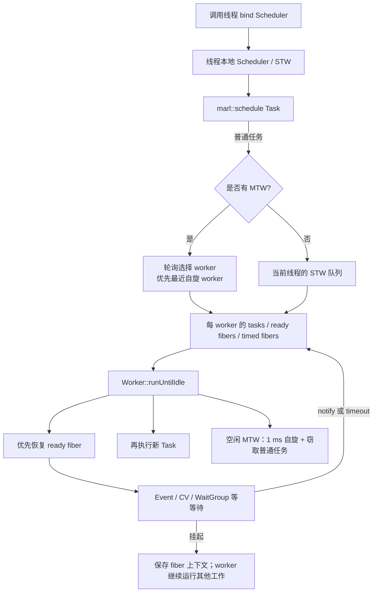
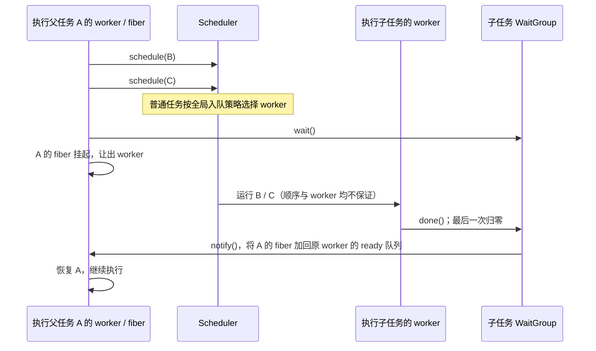
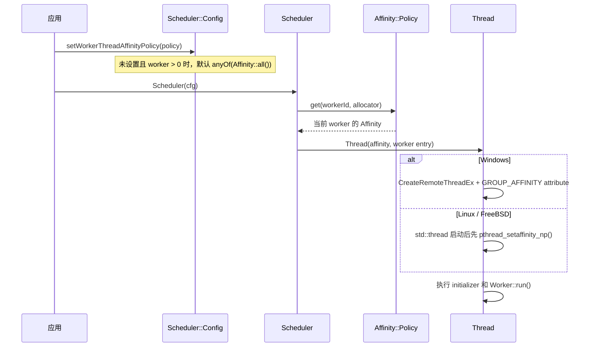

# Marl 代码调研报告

## 1. 摘要

| 项目 | 结论 |
| --- | --- |
| 调研对象 | `marl`：C++11 混合线程（OS thread）/纤程（fiber）任务调度库 |
| 代码版本 | `b8406ab`（`kokoro: Linux uses clang-18 (#283)`） |
| 调研日期 | 2026-10-12 |
| 代码规模 | 排除 `third_party/` 后，`include/`、`src/`、`examples/`、`docs/` 共 88 个源/文档文件、10,598 行；核心实现主要集中于 `src/scheduler.cpp`（771 行） |
| 验证状态 | Windows x64 Debug：构建成功，`marl-unittests` 323/323 通过，用时约 9.47 s |

Marl 的本质是一个**固定 OS 线程池上的协作式纤程调度器**。它把会等待 Marl 同步原语的任务挂起为纤程，再让同一个 OS 线程继续运行别的任务，因此能在有限线程数下承载大量相互等待的工作。它不是抢占式调度器：普通计算任务不主动让出执行权时会一直占住所在 worker。

实现的整体边界清晰，线程、纤程、同步、内存分层合理，且单元测试覆盖了单线程、1/2/4/8/64 worker、超时、纤程同线程恢复及析构排空等核心行为。主要需要优先处理的是两个确定的跨配置/跨平台正确性问题：worker 数量未被限制在内部固定上限 256 内，以及 Linux/FreeBSD 对非连续 CPU 亲和性掩码的枚举错误。除此之外，`blocking_call()` 的“每次调用创建线程”、`system_clock` 超时、`Event::any()` 的依赖保留和纤程栈峰值是生产接入时必须评估的成本。

本文是基于当前工作区源码、构建脚本和本地测试结果形成的独立技术调研，不替代特定业务负载下的性能压测或跨平台认证。

## 2. 范围与方法

调研覆盖公开头文件、五个核心 `.cpp` 实现、平台纤程后端、CMake/Bazel 构建、示例、单元测试和基准入口；不审计 `third_party/` 中的 GoogleTest/Google Benchmark 源码。阅读主线为：

1. 从 `Scheduler`、`Task` 和 `ConditionVariable` 确定任务调度与让出语义；
2. 从 `Event`、`WaitGroup`、`Ticket`、`DAG`、`Pool` 复核上层并发抽象；
3. 从 `OSFiber`、`Thread`、`Allocator` 核对跨平台上下文切换、亲和性与内存管理；
4. 从 14 个测试文件和 7 个基准文件核对覆盖范围；
5. 使用已有 CMake 构建目录重新构建并实际执行测试。

本次执行的验证命令为：

```powershell
cmake --build build --config Debug --target marl-unittests --parallel 4
.\build\Debug\marl-unittests.exe
```

构建使用 MSBuild 17.14；结果为 5 个 test suite、323 项测试全部通过。参数化测试将主要功能分别运行在 `0、1、2、4、8、64` 个 worker 配置下；其中 `0` 是单线程 worker（STW）模式。未在本次会话执行 Release、ASan/TSan、Linux/macOS/Android/Emscripten 或 Bazel 测试，这些应被视为验证边界。

## 3. 仓库与构建结构

| 目录/文件 | 职责 |
| --- | --- |
| `include/marl/` | Header-first 的公开 API 与模板实现：调度、同步、内存、容器、任务图等 |
| `src/scheduler.cpp` | worker 生命周期、队列、纤程状态机、超时和窃取逻辑 |
| `src/osfiber_*` | Windows Fiber、ucontext、Emscripten 与各 ABI 汇编上下文切换后端 |
| `src/thread.cpp` | OS 线程创建、线程名、CPU 亲和性与逻辑 CPU 数 |
| `src/memory.cpp` | 默认页/对齐分配器及 guard page 支持 |
| `src/*_test.cpp` | GoogleTest 单元与压力测试，共 14 个文件、88 个直接测试定义 |
| `src/*_bench.cpp`、`tools/bench/` | Google Benchmark 场景及 Go 的基准结果比较工具 |
| `examples/` | Hello、嵌套任务、素数有序输出、Julia 分形 |
| `CMakeLists.txt`、`BUILD.bazel` | CMake 与 Bazel 两套构建入口 |

库本身没有运行时第三方依赖；测试依赖 vendored GoogleTest，基准依赖 Google Benchmark。CMake 默认生成静态库，也可通过 `MARL_BUILD_SHARED` 生成动态库；公开目标名为 `marl`，安装后命名空间为 `marl::marl`。最低语言标准是 C++11。

## 4. 架构总览



核心原则是：**任务可能迁移，已创建的纤程不迁移**。普通任务被放入任一 worker 的任务队列；任务第一次阻塞时，当前 worker 创建/复用纤程继续承担调度工作。纤程记录了原始栈和寄存器上下文，只会被 `Fiber::notify()` 重新排到它所属 worker，因此恢复在同一 OS 线程上完成。

## 5. 调度器深度分析

### 5.1 绑定和生命周期

`Scheduler` 以线程局部变量 `Scheduler::bound` 暴露当前调度器。调用 `marl::schedule()` 前必须先 `bind()`；API 在 Debug 下通过断言检查，Release 下错误调用会继续解引用空指针，因此这是硬性使用前置条件。

`bind()` 为外部线程建立一个 `SingleThreaded Worker`（STW），并登记在线程 ID 到 worker 的映射中。`unbind()` 会先停止这个 STW、排空其待运行工作、从映射移除，再清除 TLS。析构函数会先等待所有外部线程解除绑定，然后依次停止所有多线程 worker（MTW）；因此“忘记 unbind”或存在永不唤醒的工作时，析构可无限等待。

推荐的资源边界是一个进程级 `Scheduler` 加 RAII 解除绑定：

```cpp
marl::Scheduler scheduler(marl::Scheduler::Config::allCores());
scheduler.bind();
defer(scheduler.unbind());
```

这与 README 的建议一致，也避免多个线程池彼此争用 CPU。

### 5.2 STW 与 MTW

| 模式 | 启用条件 | 执行时机 | 适合场景 |
| --- | --- | --- | --- |
| STW | `workerThread.count == 0`；每次 `bind()` 产生一个 | 任务入队后不会自动后台运行；当前纤程/线程进入 Marl 等待时才运行其他任务，`unbind()` 也会排空 | 单线程事件循环、确定性较强的协作式执行、无后台线程需求 |
| MTW | 构造时 `workerThread.count > 0` | 每个 worker 创建一个 OS 线程，在 `run()` 中持续等待和执行 | CPU 并行或大量会相互等待的任务 |

MTW 启动时可执行线程初始化回调，并可按 `Thread::Affinity::Policy` 设置亲和性。未显式提供策略时，会为可用核心创建 `anyOf` 策略。`Config::allCores()` 仅是 `setWorkerThreadCount(Thread::numLogicalCPUs())` 的快捷方式。

### 5.3 入队、均衡和窃取

普通任务的入队算法在 `Scheduler::enqueue()` 中实现：

1. `Task::Flags::SameThread` 直接入当前 worker；该标志用于“马上等待子任务”这类局部场景，避免唤醒其他 worker。
2. 有 MTW 时，优先选择近期开始自旋的 worker；若没有，则以原子递增下标轮询全部 worker。
3. 选择目标 worker 时尝试获取其队列锁；竞争失败后重新选择。
4. 没有 MTW 时，任务进入当前绑定线程的 STW；未绑定则在 Debug 失败。

每个 worker 的 `Work` 内有互斥锁保护的 `tasks`、可恢复的 `fibers`、按超时排序的 `waiting`，以及无锁快速判定用的原子 `num`（应等于前两者元素数量）。空闲 MTW 会：

- 先自旋最多约 1 ms；
- 每轮执行一组 `nop` 并检查本地新任务；
- 用 Xorshift 随机源尝试从其他 worker 的队首窃取一个**非 `SameThread`**任务；
- 仍无工作才通过条件变量休眠。

这个设计在短间隙任务下减少睡眠/唤醒延迟，并以任务窃取纠正轮询造成的不均衡；代价是空闲时最多 1 ms 的 CPU 自旋，且队列是互斥锁队列而非无锁 work-stealing deque。纤程不能被窃取，因为它们的上下文只对原 worker 的 OS 线程有效。

### 5.4 运行优先级和纤程状态机

`Worker::runUntilIdle()` 永远先处理 `work.fibers`，再处理 `work.tasks`。这是有意的内存控制：优先恢复已存在的阻塞纤程，避免先启动新任务而进一步增加纤程栈数量。

| 状态 | 含义 | 典型迁移 |
| --- | --- | --- |
| `Running` | 当前正在执行 | 等待时转为 `Yielded` 或 `Waiting`；切走时成为 `Idle` |
| `Yielded` | 无超时等待、尚未被唤醒 | `notify()` 后转为 `Queued` |
| `Waiting` | 在按时间点排序的等待集合中 | 通知/超时后转为 `Queued` |
| `Queued` | 位于可恢复纤程队列 | 被切换恢复后为 `Running` |
| `Idle` | 已完成当前调度循环，可复用为 worker 纤程 | 用于运行新的调度循环或切换给可恢复纤程 |

带谓词的等待采用关键的锁顺序：先持有 worker 锁，再释放用户锁，再挂起纤程；恢复后再重新获取用户锁并检查谓词。这样避免了“释放用户锁到真正挂起之间，通知已经发生而被丢失”的竞态。无锁、无谓词的 `Fiber::wait()` 接口仅推荐在同一线程内使用，头文件也明确标注跨线程可能丢通知。

### 5.5 嵌套任务：父任务创建、等待并恢复子任务

嵌套任务没有专用的“父子任务”对象或隐式 join 关系。父任务内再次调用 `marl::schedule()`，与外部线程调用完全使用同一个调度器和入队路径；区别在于 worker 线程启动时已经绑定了 scheduler，所以任务体内**无需再次 `bind()`**。`examples/tasks_in_tasks.cpp` 展示了父任务 A 创建子任务 B、C，随后等待它们完成的标准模式。



具体过程如下：

1. A 内部对 B、C 的普通 `schedule()` 最终调用 `Scheduler::enqueue()`。在 MTW 模式下，它们仍优先投递给自旋 worker，否则按全局轮询选择 worker；**默认不会因为 B/C 由 A 创建就优先放到 A 当前的 worker**。每个目标队列都是 `push_back`、`pop_front` 的 FIFO 队列，但跨 worker 的实际开始顺序不作保证。
2. A 调用 `WaitGroup::wait()` 时，`WaitGroup` 通过 `ConditionVariable` 检查当前是否运行在 Marl fiber；若是，就将该 fiber 登记为等待者并调用 `Fiber::wait()`，而不是阻塞 OS 线程。
3. `Worker::suspend()` 将 A 的 fiber 标为 `Yielded`（或带超时时为 `Waiting`）。当前 worker 随后按“已就绪 fiber → 空闲 fiber → 新建运行调度循环的 fiber”的顺序切换，继续处理队列中的 B、C 或其他任务。
4. B/C 的每次 `done()` 递减同一个共享计数；最后一个子任务使计数归零时调用 `notify_all()`。`ConditionVariable` 遍历等待 fiber 并调用 `Fiber::notify()`，该操作将 A 放回 **A 原属 worker** 的 `work.fibers` 队列。
5. `runUntilIdle()` 对已就绪 fiber 的优先级高于新任务，因此该 worker 下次处理时优先恢复 A；A 的谓词重新确认计数为零后从 `wait()` 返回。

因此，即使只有一个 MTW，或者在无后台线程的 STW 模式中，父任务使用 Marl 的 `WaitGroup`/`Event`/`ConditionVariable` 等待子任务也不会因“等待占住 worker”而天然死锁：父 fiber 会让出执行权，worker 能继续处理子任务。STW 的差异是没有真正并行，子任务只在外部线程或父 fiber 进入 Marl 等待后才获得运行机会；嵌套等待会按需增加/复用 fiber 来推进调用链。

下列情况则会破坏这一保证：

- 父任务调用 `std::mutex::lock()`、`std::condition_variable::wait()`、同步 I/O 或 `future::get()` 等非 Marl 阻塞接口。此时 OS worker 被真正阻塞；单 worker 下子任务无法运行，多 worker 下也可能因线程耗尽形成饥饿或死锁。
- 父任务只是入队子任务却不建立 `WaitGroup`、`Event`、`Ticket` 或业务回调等显式完成协议。调度器不会自动等待“子任务树”；父任务可以先结束，scheduler 析构时才会统一排空全部工作。
- 对局部栈上的同步原语按引用捕获。应像示例一样按值捕获 `WaitGroup`，并在子任务中用 `defer(wg.done())` 确保每一条退出路径都归还计数。

若需要明确的本地性，可手工创建 `Task` 并使用 `Task::Flags::SameThread`。这会把子任务放入父任务当前 worker 的队列，且窃取逻辑不会偷走它；但它仍是“入队后稍后执行”，不是递归立即调用，也会降低并行度。普通 `marl::schedule(lambda)` 不会自动附加该标志。

## 6. 同步与上层并发抽象

| 组件 | 实现与语义 | 使用注意 |
| --- | --- | --- |
| `ConditionVariable` | 若当前处于 Marl fiber，则将 fiber 放入内部等待表并让出；否则回退到 `std::condition_variable` | 配合 `marl::mutex` 与谓词使用；不要持有 `std::mutex` 后执行会让出的 Marl 等待 |
| `Event` | 基于共享状态、`ConditionVariable` 和 `marl::mutex`；`Auto` 每次只释放一个等待者，`Manual` 持续信号并广播 | 设计为按值捕获；`Event::any()` 由源事件自动传播信号 |
| `WaitGroup` | 原子计数归零时广播；所有副本共享同一状态 | 任务必须确保 `done()` 恰好调用一次，适合用 `defer(wg.done())` |
| `Ticket::Queue` | 以双链表链接 ticket，前序完成后激活下一项；`onCall()` 可异步安排回调 | 适合“并行计算、串行提交/输出” |
| `parallelize()` | 先安排除第一个外的函数，当前线程直接执行第一个，然后等待 | 将预期最慢的函数放在第一个参数以降低一次切换的机会 |
| `DAG<T>` | 预构建有向无环图；多入边节点使用运行期原子计数，扇出分支中仅最后一项内联调用、其余入队 | 仅构建无环图；构建后不可继续编辑；`run()` 会等待整图结束 |
| `BoundedPool` / `UnboundedPool` | `Loan` 引用计数归零自动归还对象；支持每次重建或状态保留策略 | 保留策略会跨借用保留对象状态，调用方须自行重置业务字段 |
| `blocking_call()` | 起一个临时 OS 线程运行可能阻塞的函数，调用者在 `WaitGroup` 上让出 | 这是保护 worker 的逃生通道，不是高频异步 I/O 线程池 |

所有同步原语（`ConditionVariable` 例外）都通过 `shared_ptr` 持有共享状态，因而应由 lambda **按值捕获**。这是一项重要的寿命安全约定：按引用捕获局部同步原语时，任务可能在原栈帧销毁后才运行。

## 7. 内存、纤程和跨平台实现

### 7.1 内存模型

`Allocator` 是全库内存注入点，支持 `create/destroy`、自定义 `unique_ptr` 删除器、`make_shared` 以及 STL allocator 适配。默认分配器具有两条路径：

- 普通对象：`malloc` 或手工对齐分配；
- 需要保护页的栈：通过 `mmap`/`VirtualAlloc` 分配整页，并在低/高端设不可访问页。

`TrackedAllocator` 按 Stack/Create/Vector/List/Stl 等用途记录未释放对象，测试夹具在每个用例结束时检查计数归零。这个机制对查找库内泄漏很有效。

每个 worker 会保留曾创建过的 `workerFibers`，空闲时将其放入 `idleFibers` 重用，但不会在 scheduler 生命周期中收缩。默认单纤程栈大小是 1 MiB；如果大量任务同时阻塞，worker 会创建更多纤程来继续调度，新峰值会一直保留到该 worker 销毁。因此栈大小和任务阻塞扇出必须按业务峰值配置和压测。

### 7.2 纤程后端

`src/osfiber.h` 按平台选择后端：Windows 用 Win32 Fiber API；其他原生平台默认采用与 ABI 对应的汇编保存/恢复寄存器；可选 `ucontext`；Emscripten 使用其 fiber API。各实现都将“当前线程”封装成主纤程，再创建带独立栈的工作纤程。

在本机 Windows 构建中，实际使用 `ConvertThreadToFiberEx`、`CreateFiberEx` 和 `SwitchToFiber`，并启用了浮点上下文切换标志。其他平台的汇编后端覆盖 aarch64、arm、x86/x64、loongarch64、mips64、ppc64 和 rv64。

### 7.3 线程与亲和性

`Thread` 封装 OS 线程、命名和亲和性。Windows 兼容 processor group；Linux/FreeBSD 通过 pthread affinity。对 Windows，`anyOf` 会把单个 worker 限制到一个 processor group，满足 Windows 的 group-affinity 约束；`oneOf` 可实现每 worker 固定到一个逻辑 CPU。

### 7.4 CPU 亲和性：实现、策略与实际效果

CPU 亲和性只作用于 **MTW 的 OS worker 线程**，不作用于单线程模式创建的外部调用线程，也不单独作用于 fiber。由于每个 fiber 被固定在其所属 worker 上恢复，给 worker 设置亲和性会间接约束该 worker 上运行的全部 fiber。

#### 配置入口与生效链路



调用方通过 `Scheduler::Config::setWorkerThreadAffinityPolicy()` 注入策略。若 `workerThread.count > 0` 且未设置策略，`setConfigDefaults()` 自动构造：

```cpp
auto allowed = marl::Thread::Affinity::all(cfg.allocator);
cfg.setWorkerThreadAffinityPolicy(
    marl::Thread::Affinity::Policy::anyOf(std::move(allowed), cfg.allocator));
```

之后每个 MTW 在 `Worker::start()` 中以自己的 `workerId` 调用 `policy->get(id, allocator)`，并将返回的 `Affinity` 交给 `Thread` 构造函数。平台层会先应用亲和性、再进入 scheduler 的线程初始化回调和 `Worker::run()`；因此初始化逻辑也运行在目标 CPU 集限制下。

#### Affinity 数据模型

`Thread::Affinity` 本质是一个有序 `Core` 列表，表示**该线程允许运行的逻辑 CPU 集合**；它不是 CPU 绑定的保证。`count()` 返回列表长度，`add()` 去重合并并排序，`remove()` 删除指定核心。`Core` 的平台表示不同：

| 平台 | `Core` 表示 | `Affinity::all()` 的来源 | 设置调用 |
| --- | --- | --- | --- |
| Windows | `{ group: uint8_t, index: uint8_t }`，即 processor group 与组内 CPU 位 | `GetLogicalProcessorInformationEx(RelationGroup)` 返回的各组 `ActiveProcessorMask` | 在创建线程时，以 `PROC_THREAD_ATTRIBUTE_GROUP_AFFINITY` 传入 `GROUP_AFFINITY` |
| Linux（非 Android/Bionic） | `pthread.index`（16 位逻辑 CPU 编号） | `pthread_getaffinity_np(pthread_self(), ...)` | 新 `std::thread` 的入口首先调用 `pthread_setaffinity_np()` |
| FreeBSD | 同 Linux 的单个逻辑 CPU 编号 | `pthread_getaffinity_np()` | `pthread_setaffinity_np()` |
| macOS、iOS、Android、Emscripten、Fuchsia 等 | 标记为 `supported == false` | 返回空集合或不建立平台亲和性 | 不设置 |

Windows 不能让一个线程同时跨多个 processor group，因此它在创建线程前将 `Affinity` 组装成一个 `GROUP_AFFINITY`，并在 Debug 下断言所有 `Core` 都来自同一个 group。Linux/FreeBSD 则允许一个掩码包含多个逻辑 CPU；每个 worker 线程在其入口建立 `cpu_set_t`/`cpuset_t` 后设置该掩码。

#### 内置策略的语义

| 策略 | Linux/FreeBSD 效果 | Windows 效果 | 适用方式 |
| --- | --- | --- | --- |
| `anyOf(affinity)` | 每个 worker 得到同一完整集合；OS 可在集合内迁移线程 | 先按 `workerId % affinity.count()` 选定一个 group，再返回该 group 的全部核心；不同 worker 可能共享该 group | 默认策略；希望限制到允许 CPU 集、但保留 OS 调度自由度 |
| `oneOf(affinity)` | worker *i* 固定到 `affinity[i % count]`；worker 超过 CPU 数时循环复用核心 | 同样选择一个 `(group, index)`；天然满足单 group 限制 | 需要缓存/NUMA 局部性、稳定性能对比或避免 worker 迁移 |
| 自定义 `Policy` | `get(workerId, allocator)` 可按 NUMA、业务分区、异构核或进程拓扑返回任意集合 | 返回值必须只含一个 processor group | 需要跨 group 均衡、按 NUMA node 分配或更复杂映射 |

一个显式的一核一 worker 配置示例：

```cpp
marl::Scheduler::Config cfg;
auto allowed = marl::Thread::Affinity::all();
cfg.setWorkerThreadCount(static_cast<int>(allowed.count()));
cfg.setWorkerThreadAffinityPolicy(
    marl::Thread::Affinity::Policy::oneOf(std::move(allowed)));
```

上述代码应仅在亲和性受支持且 CPU 集已验证时使用；worker 数不能超过本库的固定上限 256。若 worker 数多于 `allowed.count()`，`oneOf()` 会循环复用核心，并不会自动扩容可用 CPU 集。

#### 多 processor group 与 NUMA 的含义

默认 `anyOf()` 在 Windows 上解决了“线程不可跨 group”的正确性问题，但它的分组方式是由 `workerId` 在输入核心列表中的位置决定的。例如第一个 group 的核心排在列表前面时，前一批 worker 都会被限制在该 group；只有 worker ID 走到下一个 group 对应索引后才会分布到下一个 group。它不是按 worker 数均匀轮转各 group 的策略，也不感知 NUMA node。

在 Linux/FreeBSD 上，默认策略把每个 worker 都允许在同一个完整 CPU 集中运行，因而是“限制集合”而不是“固定核心”。这通常适合通用吞吐负载；若任务对缓存、NUMA 内存位置或尾延迟敏感，应通过 `oneOf()` 或自定义策略明确分配。注意亲和性只影响调度位置，不会自动把任务数据、分配器内存或 fiber 栈迁移到相同 NUMA node；这些仍由应用的 first-touch/分配策略决定。

#### 现有实现的限制与验证建议

1. `Config::allCores()` 的 worker 数来自 `Thread::numLogicalCPUs()`：Windows 统计系统 active processor 数，POSIX 使用 `sysconf(_SC_NPROCESSORS_ONLN)`；它与 `Affinity::all()` 的允许 CPU 集是两条独立路径。在容器、cpuset 或进程受限环境中，在线 CPU 数可大于实际允许 CPU 数，默认配置可能创建过多 worker，并把它们压在较小 CPU 集上。建议在支持亲和性的系统上以 `Affinity::all().count()` 为优先 worker 数来源，空集合时再回退到在线 CPU 数。
2. Linux/FreeBSD 的 `Affinity::all()` 当前把 `CPU_COUNT()` 的“置位数量”错误当成连续的 CPU 编号范围，未检查每一位。允许集合为 `{4, 6}` 时，代码会返回 `{0, 1}`。这是本报告第 9 节列出的 P1 正确性缺陷；修复应遍历 `CPU_SETSIZE`/平台掩码容量并使用 `CPU_ISSET(i, &cpuset)`。
3. Linux/FreeBSD 的 `pthread_setaffinity_np()` 返回值目前被忽略。无效 CPU 编号、权限/容器策略限制等失败会静默退化为 OS 默认调度，应记录错误、在 Debug 下断言并提供可查询的诊断。
4. Windows 的 `Affinity::all()` 读取的是系统 processor group 的 `ActiveProcessorMask`，而不是显式的进程约束查询。对于受外部工具、Job Object 或容器限制的进程，应在目标系统做集成测试，确认该集合与进程实际可执行 CPU 一致。
5. 现有单元测试只验证 `Affinity` 的增删、`oneOf()` 轮转和 `Affinity::all()` 非空；没有验证 OS 调用实际生效、非连续 cpuset、跨 processor group 或默认 worker 数与允许 CPU 集一致性。建议增加这些平台回归测试，并在运行时记录每个 worker 的最终 affinity。

## 8. 性能特征与适用边界

### 优势

- 任务在 Marl 原语上等待时不占用 OS 线程，适合扇出/扇入、阶段化流水线、任务图和大量协调等待。
- 默认 `allCores()` 配置配合亲和性，可将 CPU 并行度限制在可用逻辑核附近。
- 恢复纤程优先和 idle fiber 重用降低重复建栈与内存峰值增长速度。
- 短时自旋、轮询入队、随机窃取为小任务负载提供较低延迟和基本负载均衡。
- STW 模式使调度器可嵌入单线程主循环，而非强制后台线程池。

### 不适合或需额外封装的场景

- 长时间纯 CPU 任务：不会被抢占，应在任务层自行切分或限制单次执行时间。
- 直接调用 `std::mutex::lock()`、同步 socket/文件 I/O、阻塞系统调用：会卡住该 worker；需改为异步接口、短临界区，或审慎使用 `blocking_call()`。
- 高频且长时的外部阻塞调用：`blocking_call()` 一次一线程，容易形成线程风暴；应改为有界专用 I/O 线程池或异步 I/O。
- 需要任务异常隔离/`future` 异常传播/取消/优先级/截止期的系统：当前 `Task` 只是 `std::function<void()>`，没有这些一等概念，需要上层协议。
- 需要跨 worker 迁移 continuation 的运行时：Marl 刻意把 fiber 固定到创建 worker，换取简单和栈安全。

## 9. 发现的问题与改进建议

风险等级按“在合理配置或常见部署中造成错误/资源耗尽的可能性和影响”评定；前两项是直接由源码可证明的正确性缺陷，其余为设计风险或工程限制。

| 优先级 | 发现 | 代码证据 | 影响 | 建议 |
| --- | --- | --- | --- | --- |
| P0 | worker 数量没有边界校验 | `MaxWorkerThreads` 为 256，但 `Config::setWorkerThreadCount(int)` 原样赋值；构造/析构按该值索引两个固定 `std::array` | 传入大于 256 的值会越界写/读，`allCores()` 在大机器上也可能生成该值，属未定义行为 | 在 setter 和构造函数校验 `0 <= count <= MaxWorkerThreads`，失败时返回错误或终止；增加 256/257 与 `allCores()` 上限测试 |
| P1 | 默认 worker 数与实际允许 CPU 集来源不一致 | `allCores()` 使用系统在线 CPU 数；默认 affinity 则从 `Affinity::all()` 获取；两者独立且对容器/cpuset 的语义不同 | 受限进程可能创建远多于可运行 CPU 的 worker，产生过度上下文切换、自旋竞争和尾延迟 | 受支持平台优先以已验证的允许 CPU 集大小确定默认 worker 数；增加 cpuset/Job Object 集成测试 |
| P1 | Linux/FreeBSD 亲和性枚举错误处理非连续 CPU 集 | `Thread::Affinity::all()` 以 `CPU_COUNT()` 的结果作为 `0..count-1` 的 CPU 编号，而非遍历掩码并用 `CPU_ISSET()` 判断 | 容器/cpuset 只开放如 CPU 4、6 时，会错误选择 CPU 0、1；轻则亲和性设置失败，重则违背部署隔离策略 | 遍历 `0..CPU_SETSIZE`，仅对 `CPU_ISSET(i)` 的编号加入；为非连续掩码加入平台测试 |
| P2 | pthread 亲和性设置失败被静默忽略 | Linux/FreeBSD 的 `Thread::Impl::setAffinity()` 不检查 `pthread_setaffinity_np()` 返回值 | 无效 CPU、权限或容器限制会悄然回退到 OS 默认调度，排障困难 | 检查返回码，记录目标 CPU 集和错误；提供测试/诊断接口验证实际生效 |
| P1 | 任务和阻塞回调没有异常边界 | `Task::operator()`、worker 运行循环、`blocking_call()` 的线程 lambda 均无 `try/catch` | 异常可能越过 OS 线程/纤程入口并导致 `std::terminate`，同时清理/唤醒协议无法保证 | 明确“任务不得抛异常”的 API 合约，或捕获并存储 `exception_ptr`，确保解绑和 `wg.done()` 通过 RAII 执行；补异常测试 |
| P1 | `blocking_call()` 每次新建一个 OS 线程 | `include/marl/blockingcall.h` 直接构造 `std::thread`，无复用、无上限 | 高并发阻塞调用可耗尽线程、栈、句柄并造成调度抖动 | 提供可配置的有界 blocking executor，或在业务层用信号量限流；监控调用数和排队长度 |
| P2 | 定时等待使用 `system_clock` | `Scheduler::TimePoint`、`ConditionVariable::wait_for()` 和超时扫描均基于系统墙钟 | NTP/人工改时会导致超时提前或延后 | 内部调度和 `wait_for()` 改用 `steady_clock`；保留显式绝对时间 API 时清晰区分时钟语义 |
| P2 | `Event::any()` 对源事件保留派生事件的强引用，且没有注销 | 源 `Shared::deps` 向量 `push_back(any.shared)`，没有移除路径 | 若长期存活的源事件反复创建并丢弃 `any`，依赖对象累积，后续 `signal()` 的传播成本也增长 | 改用弱引用并在 signal 时清理失效项，或返回可取消 subscription；至少在文档中规定生命周期 |
| P2 | 纤程栈峰值会保持至 worker 销毁 | 默认 1 MiB；`workerFibers` 保存所有历史创建纤程，只进入 `idleFibers` 复用 | 突发的大量同时阻塞任务会抬高长期内存占用 | 针对阻塞并发数设置较小、经验证的 `fiberStackSize`；考虑空闲栈回收阈值和指标 |
| P3 | 部分前置条件只在 Debug 检查 | `MARL_ASSERT_HAS_BOUND_SCHEDULER` 在 Release 为空；随后 `schedule()` 仍使用 `Scheduler::get()` | 未 bind 调用在 Release 可能空指针崩溃而非可诊断错误 | 对公共 API 保留轻量运行时检查，或让 `schedule()` 返回状态/显式传入 scheduler |
| P3 | allocator 传播不完全一致 | `WaitGroup` 接收 `Allocator*`，但共享 `Data` 使用 `std::make_shared`；`Ticket::Queue::Shared` 同样使用标准分配 | 使用自定义 allocator 做内存归因/隔离时，部分控制块和状态不会纳入其统计 | 统一使用 `allocator->make_shared`，并补充 allocator 归因测试 |
| P3 | 内置 Trace 默认被源代码宏永久关闭 | `include/marl/trace.h` 和 `src/scheduler.cpp` 直接定义开关为 0，CMake 无相应选项 | 生产性能定位需改库源并重编译 | 改为可由编译定义覆盖的宏，增加 `MARL_TRACE_ENABLED` CMake 选项 |

## 10. 建议的实施路线

1. **先修正确性**：限制 worker 数量；让默认 worker 数与进程允许 CPU 集一致；修复 Linux/FreeBSD 非连续 affinity 掩码遍历并检查 pthread 返回码；分别添加容器/cpuset 回归测试。
2. **定义失败语义**：写明任务是否允许抛异常；若允许，建立捕获、传播、清理及 worker 存活策略。无此约定前，业务任务应将异常在 lambda 内部消化并上报。
3. **控制阻塞资源**：不要把 `blocking_call()` 当线程池；在库或接入层增加有界执行器、取消和指标。
4. **提升时间正确性与可观测性**：内部相对超时改为 `steady_clock`，使 trace 可配置，并输出 worker 队列长度、创建纤程数、窃取成功率和阻塞线程数。
5. **扩展验证矩阵**：至少增加 Linux Release、ASan、TSan 与非连续 cpuset 环境；性能发布前跑现有 7 个微基准并保留基线。

## 11. 安全集成清单

- 进程通常只创建一个长期存活的 `Scheduler`；每个外部调用线程都严格 `bind()`/`unbind()`。
- 调度后的 lambda 对 `Event`、`WaitGroup`、`Ticket` 等按值捕获；不要引用局部同步对象。
- 等待必须建立在 `marl::ConditionVariable`、`Event`、`WaitGroup` 等 Marl 原语上；在会让出的等待前不要持有 `std::mutex`。
- 嵌套任务须显式建立完成协议：父任务在 Marl 原语上等待子任务，子任务以 `defer(wg.done())` 完成；不要假定 scheduler 会自动追踪或 join 子任务树。
- 子任务默认与父任务没有调度亲缘关系，可落到任意 MTW；只有显式 `Task::Flags::SameThread` 才会留在父 worker，且应仅在确有局部性收益时使用。
- 将长计算切成可完成的任务单元；让出点由同步边界决定，库不抢占。
- 限制同时阻塞任务数和 `blocking_call()` 调用数，按峰值计算纤程栈与辅助线程资源。
- 明确任务异常策略；当前最稳妥的做法是在任务体内捕获异常并转化为业务错误状态。
- 对 Linux 容器、cpuset、NUMA 或超大核数机器，在合入 P0/P1 修复前不要依赖 `allCores()` 与默认 affinity 的正确性。

## 12. 关键代码导航

| 主题 | 入口 |
| --- | --- |
| 调度器配置、公开 API、任务入队包装 | `include/marl/scheduler.h` |
| 绑定、worker 生命周期、队列、窃取、状态迁移 | `src/scheduler.cpp` |
| 纤程后端选择 | `src/osfiber.h` |
| Windows 纤程实现 | `src/osfiber_windows.h` |
| 其他 ABI 的寄存器切换 | `src/osfiber_asm_*.S/.h` 与 `src/osfiber_*.c` |
| 条件变量的纤程/线程双路径 | `include/marl/conditionvariable.h` |
| Event、WaitGroup、Ticket | `include/marl/event.h`、`waitgroup.h`、`ticket.h` |
| DAG 和 parallelize | `include/marl/dag.h`、`parallelize.h` |
| 内存分配和对象池 | `include/marl/memory.h`、`pool.h`、`src/memory.cpp` |
| 线程、亲和性 | `include/marl/thread.h`、`src/thread.cpp` |
| 调度器实现说明 | `docs/scheduler.md` |

## 13. 结论

Marl 的核心实现与 API 目标一致：以少量固定 OS 线程承载大量可协作等待的 C++ 任务。它的强项是低依赖、跨平台、可定制分配器、纤程等待不阻塞 worker，以及覆盖良好的基础同步/任务图能力。对计算型并行、任务图、并行后串行提交、引擎/工具链中的可控协作调度，它是合适的轻量基础设施。

生产接入前应先完成 worker 上限与非连续 CPU 亲和性修复，并明确异常与阻塞调用策略。完成这些后，再以实际任务粒度、阻塞并发度、内存上限和目标平台上的基准数据决定 worker 数、纤程栈大小与 affinity 策略，才能稳定兑现该调度模型的收益。
